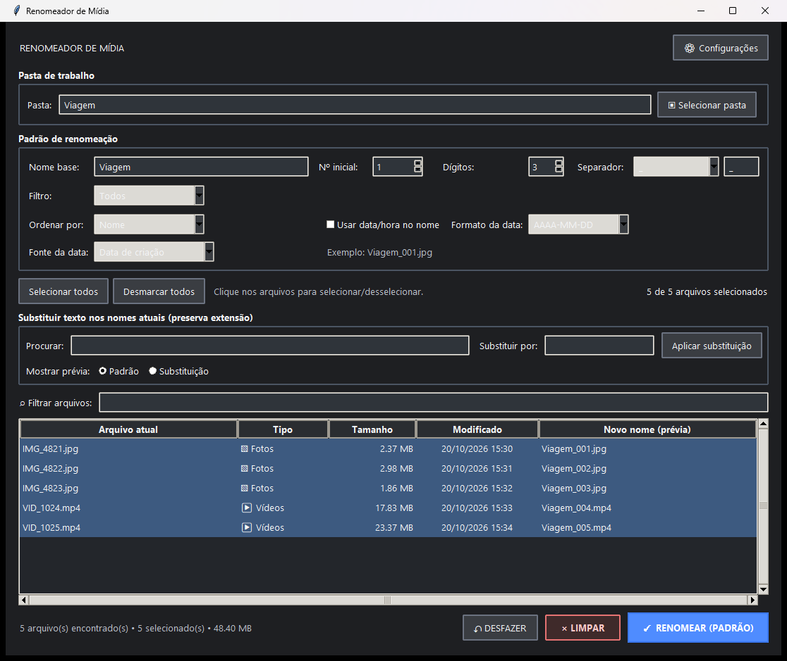

# mrenamer

Seus arquivos, com os nomes certos. Renomeador em lote para Windows, com prévia, sequências e substituição de texto.

[](https://github.com/thegodKoDDa/mrenamer/actions/workflows/ci.yml)



*Prévia da interface com nomes e arquivos fictícios; nenhuma mídia pessoal foi usada.*

## Recursos

- Renomeação de fotos, vídeos, áudios e documentos com prévia dos novos nomes.
- Sequências com nome base, separador, contador e data opcional.
- Substituição de trechos do nome, preservando a extensão original.
- Busca, filtros por categoria, ordenação e seleção múltipla.
- Carregamento de pastas e subpastas, arrastar e soltar e monitoramento da lista.
- Validação de nomes e conflitos, desfazer na sessão e recuperação assistida de lotes.
- Tema claro e escuro.

## Começar

### Executar no Windows

Requisitos: **Python 3.10 ou superior**, com Tkinter. O ambiente de distribuição é validado com Python 3.13.

```powershell
git clone https://github.com/thegodKoDDa/mrenamer.git
cd mrenamer
python -m venv .venv
.\.venv\Scripts\python.exe -m pip install -r renamer/Renomeador_de_Midia_Projeto/requirements.txt
.\.venv\Scripts\python.exe renamer/Renomeador_de_Midia_Projeto/media_renamer.py
```

O repositório disponibiliza o código-fonte. Ainda não há instalador ou executável publicado em Releases. Para gerar o executável no Windows, consulte o [guia de desenvolvimento](docs/development.md).

## Uso rápido

1. Escolha uma pasta e selecione os arquivos.
2. Configure uma sequência no modo **Padrão** ou preencha os campos de **Substituição**.
3. Confira a coluna **Novo nome** e confirme a operação.

Exemplo de sequência:

```text
IMG_4821.jpg  →  Viagem_001.jpg
IMG_4822.jpg  →  Viagem_002.jpg
```

A renomeação altera o nome, sem converter o formato ou o conteúdo. **Desfazer** funciona durante a sessão. A recuperação de lotes interrompidos exige um mapa compatível e confirmação; ela não ocorre automaticamente após reiniciar. Consulte o [manual](docs/user-guide.md) e os [limites conhecidos](docs/KNOWN_ISSUES.md).

## Desenvolvimento

Python/Tkinter na interface e motor de renomeação independente da GUI. Na raiz do projeto:

```powershell
python -m unittest discover -s tests -v
python -m unittest discover -s scripts -p "test_*.py" -v
```

Os testes usam arquivos fictícios e preferências temporárias. As verificações rodam também no GitHub Actions, no Linux e no Windows; os testes da interface exigem Windows.

| Diretório | Conteúdo |
| --- | --- |
| `renamer/Renomeador_de_Midia_Projeto/` | Interface, motor e configuração de empacotamento |
| `tests/` | Regressões e integração Windows |
| `scripts/` | Build, benchmark e continuidade |
| `docs/` | Guias e prévia da interface |
| `renamer original/` | Fontes históricas preservadas |

Para build e benchmark, consulte o [guia de desenvolvimento](docs/development.md).

## Documentação

- [Manual de uso](docs/user-guide.md)
- [Arquitetura](docs/architecture.md)
- [Limites conhecidos](docs/KNOWN_ISSUES.md)
- [Checkpoints e recuperação](docs/continuity.md)
- [Histórico de versões](CHANGELOG.md)

## Contribuir

Consulte o [guia de contribuição](CONTRIBUTING.md). Para relatar um problema ou propor uma melhoria, [abra uma issue](https://github.com/thegodKoDDa/mrenamer/issues).
